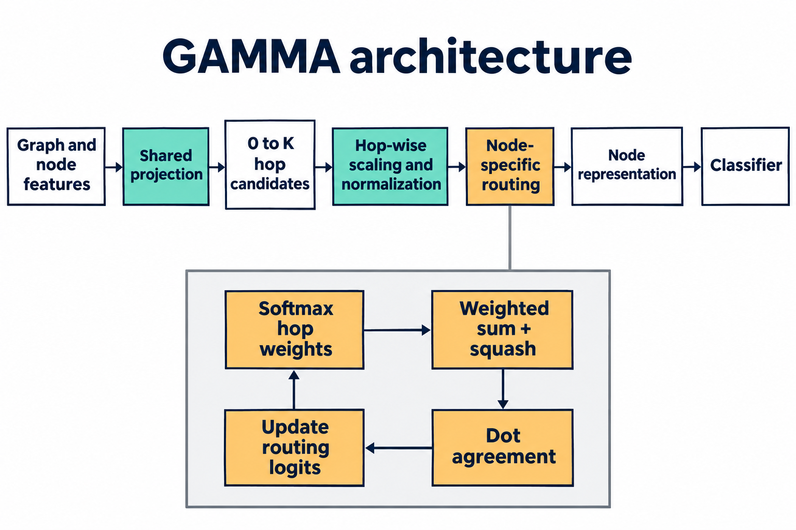
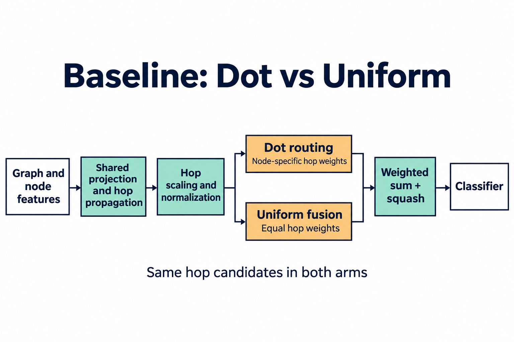

# Baseline：GAMMA 复现与门控对照

[Story line](../../STORYLINE.md) · [全部实验](../README.md)

## 架构与门控对照

第一张图概括原论文中的 GAMMA 层。第二张图展示本地复现的对照设计。Dot 和 Uniform 分别运行，保留相同的 hop 候选、逐 hop 缩放和分类头。

## 复现问题

范围限定六个异配（heterophilic）数据集：Texas、Wisconsin、Cornell、Chameleon、Squirrel、Actor。
同配数据集只保留为历史背景，不作为这条课程主线的主要证据。
复现级别为 Component；教师批准仍为 `NOT_VERIFIED`。

这里有两个不同的问题：GAMMA 的整体准确率是否接近论文，以及动态门控相对均匀融合是否带来收益。
准确率接近不能单独证明门控收益，也不能证明本地重现了相对其他 GNN 的 SOTA 排名。

## 证据分层

| 子实验 | 用途 | 边界 |
| --- | --- | --- |
| [historical_readme](historical_readme/README.md) | 官方 README 路径的历史性能参照 | 包含同配背景；保留浅拷贝最佳 checkpoint 等历史限制 |
| [early_gate](early_gate/README.md) | 早期 K2 门控探索 | 初始化不同，不与后期主对照混合 |
| [gate_sweep](gate_sweep/README.md) | 正式呈现的本地 Dot / Uniform、K2–4 对照 | 360 条历史执行，十 splits、每 split 一个训练 seed，执行 commit UNKNOWN |

历史 README 六个异配数据集相对论文 Table 1 的平均绝对差距约 1.81 pp，仅为描述性背景。
本地 Dot−Uniform 在 18 个 Dataset×K 条件中 11 正、7 负，平均 +1.51 pp；Holm18 后没有显著比较。
整体准确率近似重现；门控获得部分正向支持，一致增益未在本地协议中重现。
对“门控总体有益”这一宽泛主张，现有证据判为 inconclusive；不是对论文原协议的反证。
这段结论是当前材料整理的解释，不伪称历史预注册的判定规则。

## 论文与本地的差异

论文写明两层 GNN、50/25/25 划分、固定 500 epochs 和验证集网格搜索。
本地为一层实际 GAMMA 加分类头、60/20/20、早停、固定超参数，并明确包含 0-hop。
论文 hop 标签不直接等同于本地 powers；论文文字与代码实现的归一化等差异也需保留。
完整数值、单位、差异与不确定性见 [claim map](../../docs/CLAIM_AND_REPRODUCTION.md)
和 [历史结果](../../reports/RESULTS_SUMMARY.md)。

## 如何引出实验 1

门控收益具有数据集依赖性。首先测试：把 Dot agreement 换成可学习 scorer，是否能稳定改善？
[进入实验 1](../01_scorer/README.md)。
