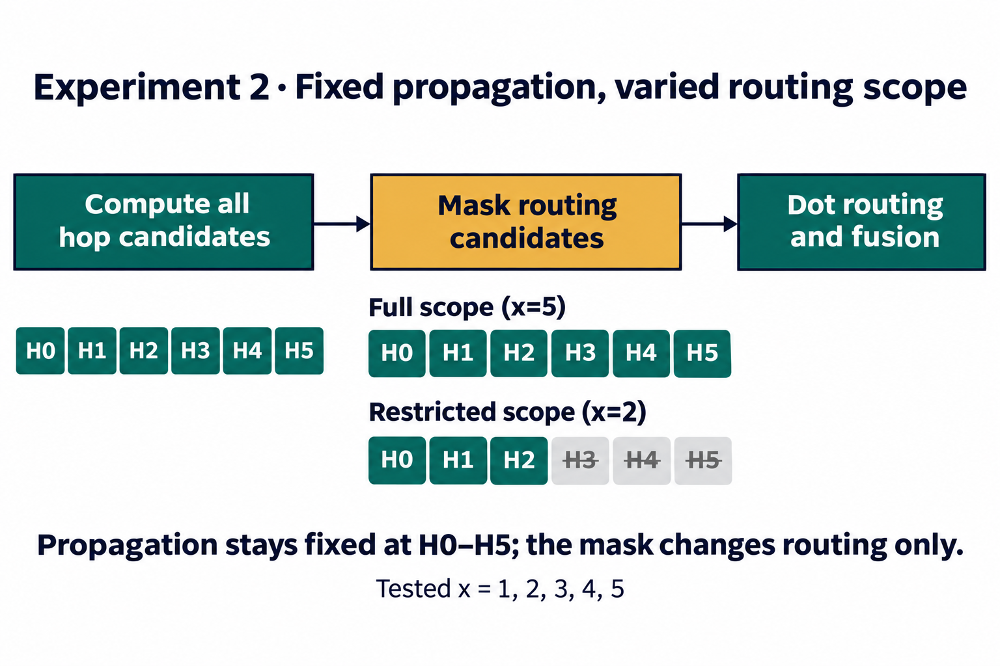

# 实验 2：固定传播、改变 Hop 路由范围

[实验 1](../01_scorer/README.md) → 实验 2 → [实验 3](../03_distance_query/README.md)

图以 x=2 对比 x=5。两组均先计算 H0 至 H5，掩码在各轮 softmax 前限制可用候选。

## 想法与假设

固定传播到 powers 0..5，仅允许 0..x 参与路由，x=1..5。
想法：用受控的候选范围研究限制高阶 hop 是否有益，为后续 hop 选择提供依据。
假设增加候选 hop 不保证精度单调增加，不同数据集适合的范围可能不同。
这是固定范围的消融与改进探索，尚未实现自动的逐节点 hop selector。

## 公平对照

x5 是本实验新训练的完整范围对照。所有 x 都保留相同参数、完整初始化和传播计算。
六数据集、十 splits、五范围，共 300 次训练，含 12 个复用 Pilot cells；
另对 60 个 x5 checkpoint 做 300 次推理掩码评估。两类结果分别报告。
每个 split 一个训练 seed；不能把它写成每 split 三 seeds。

## 结果与解释

六个数据集的均值曲线均非单调；描述性的验证集均值最佳范围为 Texas=2、Wisconsin=3、
Cornell=3、Chameleon=5、Squirrel=1、Actor=1。这不是用 test 挑选最终赢家。
24 个 x-vs5 主比较经各数据集内 Holm4 后均未显著。

Squirrel x1 的推理删 hop 与从头训练受限模型之间，均值差为 −4.48 pp（post-hoc−retrain）。
因此训练时限制候选与训练后直接删除并不等价。不能仅由删除结果判断某 hop 对重训架构的必要性。
所有范围仍计算完整传播，不宣称传播加速。没有据此证明高阶信息天然有害。

## 文件和下一步问题

[完整实验、配置和代码](hop_scope_study/README.md) ·
[结果](hop_scope_study/docs/03_RESULTS.md) ·
[限制](hop_scope_study/docs/04_INTERPRETATION_AND_LIMITATIONS.md)

范围重要，但范围内的表示仍是 Walk 聚合。下一问：换成 Exact-distance 候选，或更换 Query，是否有益？
[进入实验 3](../03_distance_query/README.md)。教师批准仍 `NOT_VERIFIED`。
