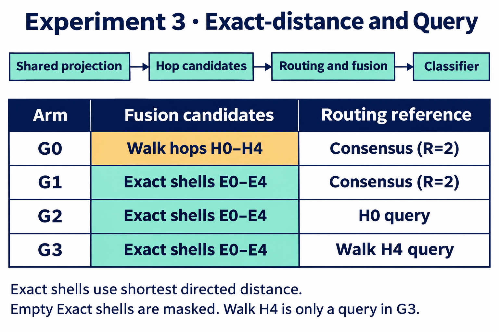

# 实验 3：Exact-distance 与 Query 设计

[实验 2](../02_hop_scope/README.md) → 实验 3 → [完整结论](../../STORYLINE.md)

G3 使用 Walk H4 作为 Query，并从 Exact-distance 候选中融合。实现细节见[模型流程图](exact_distance_query/docs/ARCHITECTURE.md)。

## 想法与假设

Walk 聚合混合多条路径与不同最短距离的节点。想法：使用严格最短距离 shell 构造 hop 候选，
再比较 Consensus、H0 Query 和原 Walk-H4 Query，检验候选表示和参考向量是否影响融合收益。
预期改进属于假设，不能由结构直觉直接认定成立。

## 四组受控比较

| 组 | 聚合候选 | Query / routing | 对照用途 |
| --- | --- | --- | --- |
| G0 | 原 Walk | 原 Consensus | 本实验匹配基线 |
| G1 | Exact-distance | Consensus | 相对 G0 比较聚合方案这一整组变化 |
| G2 | Exact-distance | 归一化 H0 | 相对 G1 比较 H0 Query |
| G3 | Exact-distance | 归一化原 Walk-H4 | 相对 G1 比较 H4 Query |

同参数、初始化、splits、训练预算和选模路径。六数据集×十 splits×三 seeds×四组=720 次主训练，
含 48 个 Pilot 和 4 个 Smoke cells 的校验复用；另有 9 个 empty-policy 控制训练及 720 次推理 profiling。
这不是完整 aggregation×query 析因设计；未执行 Walk+H0/H4。

## 结果与解释

G1−G0 有升有降，没有比较通过各数据集内 Holm3。Exact-distance 未提供普遍精度收益。
Actor 的 G2−G1 为 +1.237 pp，名义 Holm3 p=.00586；Texas/Chameleon 的 G3−G1 为负向，
名义 Holm3 p=.02344/.03516。splits 重叠，统计量仍是同图内的描述性证据。

G2 平均约 98.5%–100% 权重落在 0-hop，支持对自身特征的高度依赖，不能解释为更好选择远邻。
缺同协议 H0-only 对照，不能直接等同于无图模型。Query 范数不同，集中度也可能受分数尺度影响。
G1 相对 G0 同时改变路径计数、距离混合、shell 大小、空 shell 策略和实现计算，不能作单一因果归因。
推理更快的结果包含计算复用和算子差异，并需单独报告一次性构图成本。

[完整实验入口](exact_distance_query/README.md) ·
[全部数值](exact_distance_query/docs/03_FULL_RESULTS.md) ·
[机制、效率与负结果](exact_distance_query/docs/04_INTERPRETATION.md)

教师批准和人工科学核验仍 `NOT_VERIFIED`。后续 H0-only、统一 Query 范数/温度或优化 Walk 对照仅为建议，
本次整理不执行新实验。
