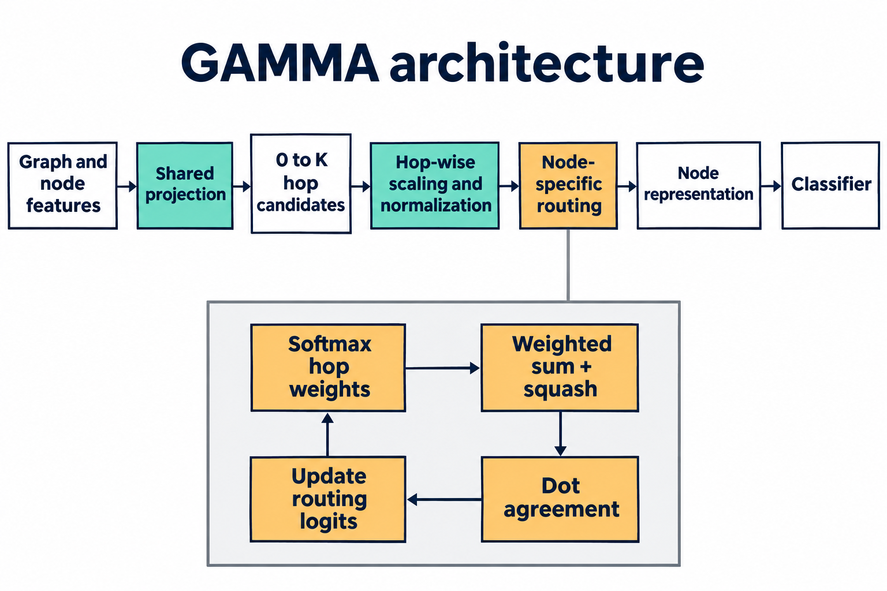
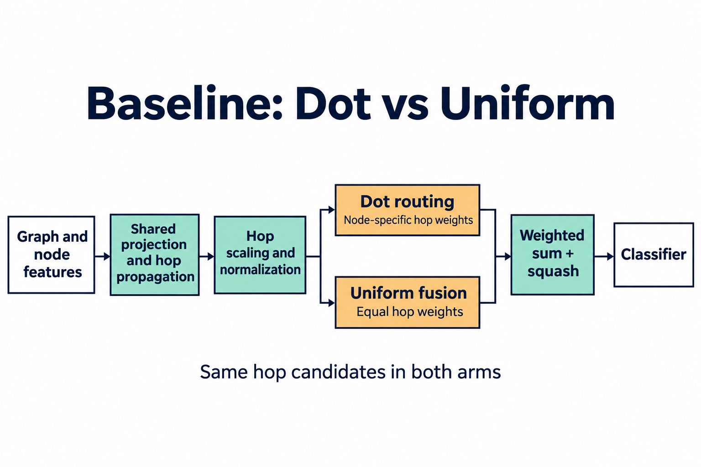
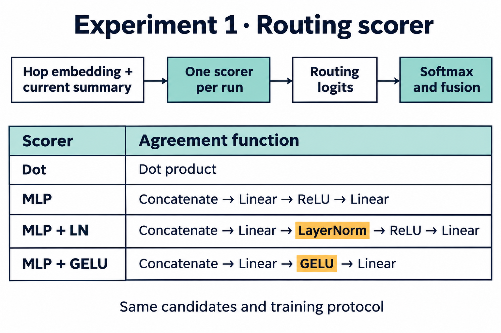
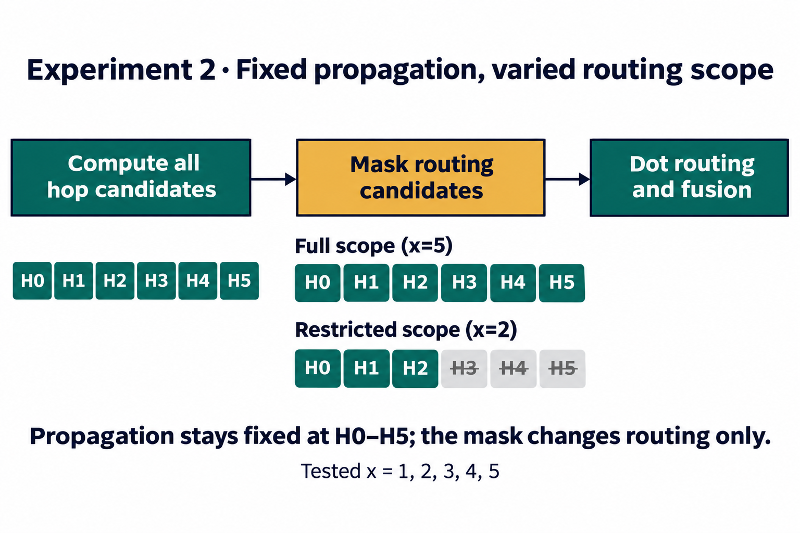
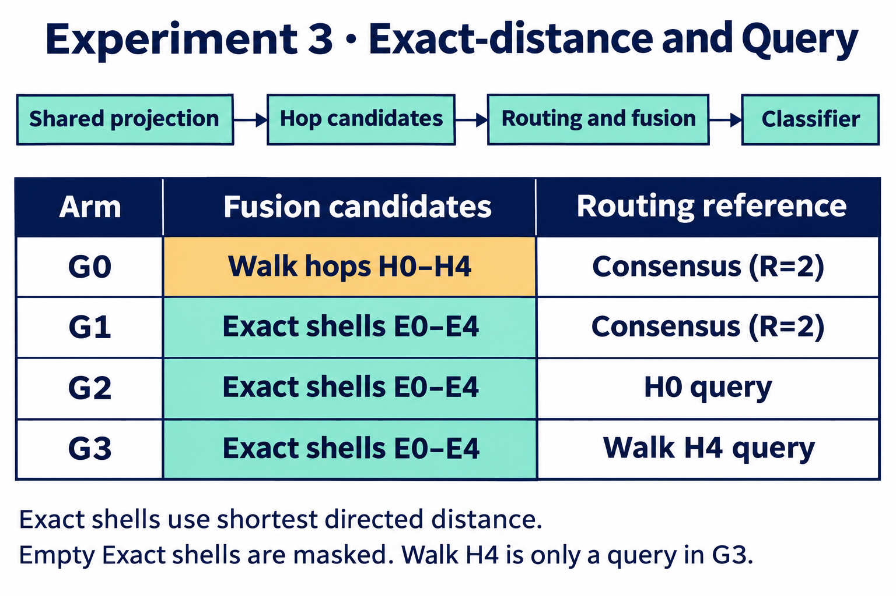

# GAMMA 架构图总览

这组图由内置 ImageGen 生成。原始架构根据 GAMMA 论文绘制，实验图依据仓库的模型实现与实验协议绘制。

## 原始 GAMMA

路由从 hop 权重计算加权表示，经 squash 后计算 Dot agreement，并更新下一轮的 logits。图示参考 [GAMMA 论文](https://amir-ghz.github.io/PDFs/GAMMA.pdf)与[本地实现对照](../docs/CLAIM_AND_REPRODUCTION.md)。

## Baseline · Dot vs Uniform

Dot 组使用逐节点的动态权重，Uniform 组对参与的 hop 等权融合。参见 [Baseline 实验](00_baseline/README.md)。

## 实验 1 · Scorer

四行代表四种独立配置。计算出的 agreement 用于更新路由 logits。参见 [Scorer 实验](01_scorer/README.md)。

## 实验 2 · Hop 范围

图中 x=2 是受限范围示例。它与 x=5 都计算全部六个 hop 表示。参见 [Hop 范围实验](02_hop_scope/README.md)。

## 实验 3 · Exact-distance / Query

G1–G3 的融合候选来自 Exact-distance shells。G3 另外计算 Walk H4 作为 Query。参见 [Exact-distance / Query 实验](03_distance_query/README.md)。
