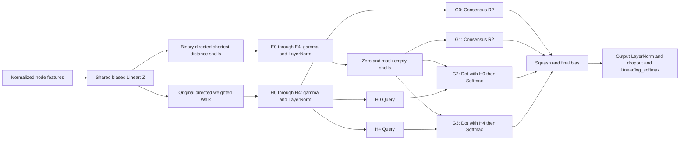

# Audited model differences

Only the selected group executes. G0 retains five independent projections and
ten original propagations; G3 computes H4 from the same Z used by Exact shells.
H4 is only a query, never an additional fusion candidate. G2 uses the same shared
normalization/scaling definition for H0. No gradients are detached.

At R2, first valid-hop uniform fusion is squashed to v0, logits=dot(hop,v0).
Second softmax is used_alpha; second squash and final bias produce the layer
output. G1-one-shot uses v0 as its query and is checked numerically with nonzero
fusion/LN biases and real selected checkpoints. The unused final logits update
is never converted into a reported output weight.
