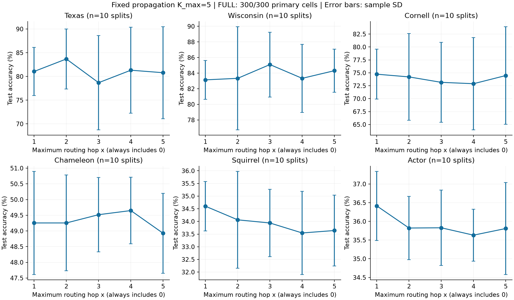
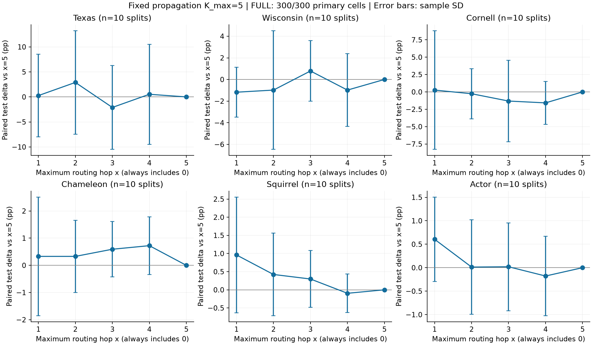
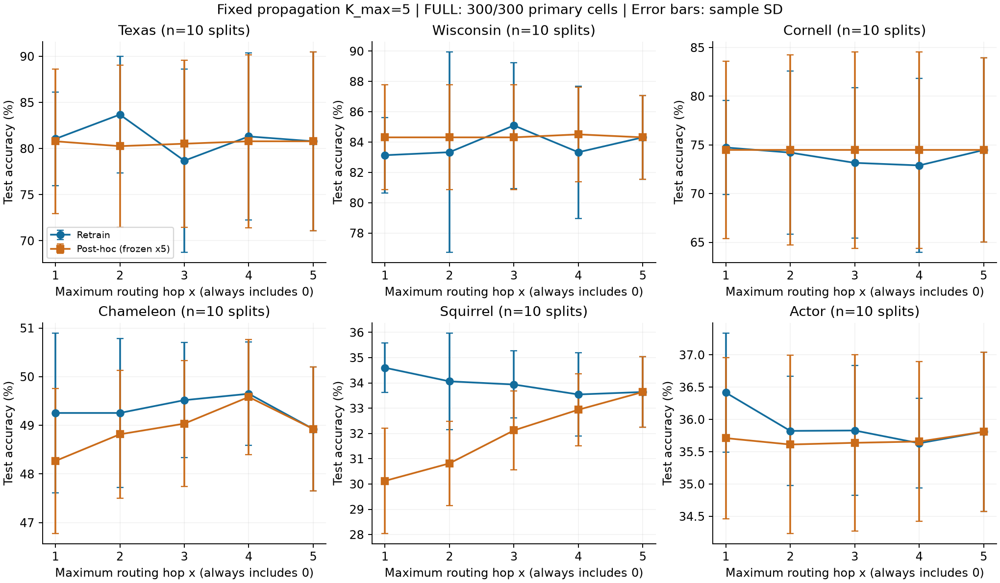

# Fixed-propagation / variable-routing results

**FULL**: 300/300 primary cells; 0 failed/incomplete attempts; 0 not-run cells. Post-hoc 300/300 evaluations from 60/60 checkpoints. Generated 2026-10-25T11:21:48.711550+00:00.

Test accuracy %, equal-weight split mean +/- sample SD (ddof1); n in the CSVs. Propagation fixed0..5, routing active0..x.

| Dataset | x1 | x2 | x3 | x4 | x5 |
| --- | --- | --- | --- | --- | --- |
| Texas | 81.05 +/- 5.08 | 83.68 +/- 6.30 | 78.68 +/- 9.96 | 81.32 +/- 9.07 | 80.79 +/- 9.69 |
| Wisconsin | 83.14 +/- 2.48 | 83.33 +/- 6.62 | 85.10 +/- 4.15 | 83.33 +/- 4.36 | 84.31 +/- 2.77 |
| Cornell | 74.74 +/- 4.84 | 74.21 +/- 8.40 | 73.16 +/- 7.73 | 72.89 +/- 8.95 | 74.47 +/- 9.45 |
| Chameleon | 49.25 +/- 1.64 | 49.25 +/- 1.53 | 49.52 +/- 1.18 | 49.65 +/- 1.06 | 48.93 +/- 1.27 |
| Squirrel | 34.60 +/- 0.98 | 34.06 +/- 1.91 | 33.94 +/- 1.32 | 33.54 +/- 1.64 | 33.64 +/- 1.40 |
| Actor | 36.41 +/- 0.92 | 35.82 +/- 0.84 | 35.83 +/- 1.01 | 35.63 +/- 0.70 | 35.81 +/- 1.23 |

Validation accuracy %, same validation-best checkpoints, mean +/- sample SD:

| Dataset | x1 | x2 | x3 | x4 | x5 |
| --- | --- | --- | --- | --- | --- |
| Texas | 81.67 +/- 7.20 | 85.83 +/- 6.47 | 82.22 +/- 6.95 | 82.78 +/- 7.15 | 84.17 +/- 7.41 |
| Wisconsin | 86.80 +/- 5.59 | 88.20 +/- 5.53 | 89.40 +/- 6.11 | 89.00 +/- 3.80 | 88.40 +/- 5.06 |
| Cornell | 81.39 +/- 6.94 | 81.39 +/- 4.73 | 81.94 +/- 5.75 | 81.94 +/- 6.31 | 81.39 +/- 4.15 |
| Chameleon | 51.32 +/- 1.74 | 51.74 +/- 1.62 | 51.96 +/- 1.31 | 52.24 +/- 1.73 | 52.59 +/- 1.94 |
| Squirrel | 36.79 +/- 1.63 | 36.55 +/- 1.60 | 35.71 +/- 1.28 | 35.71 +/- 1.20 | 35.84 +/- 1.33 |
| Actor | 36.64 +/- 0.79 | 36.17 +/- 0.85 | 36.05 +/- 0.91 | 35.84 +/- 0.82 | 35.80 +/- 0.85 |

Paired test delta vs x5, pp, mean +/- sample SD:

| Dataset | x1 | x2 | x3 | x4 |
| --- | --- | --- | --- | --- |
| Texas | 0.26 +/- 8.27 | 2.89 +/- 10.34 | -2.11 +/- 8.40 | 0.53 +/- 9.99 |
| Wisconsin | -1.18 +/- 2.30 | -0.98 +/- 5.49 | 0.78 +/- 2.80 | -0.98 +/- 3.36 |
| Cornell | 0.26 +/- 8.55 | -0.26 +/- 3.61 | -1.32 +/- 5.85 | -1.58 +/- 3.09 |
| Chameleon | 0.33 +/- 2.18 | 0.33 +/- 1.33 | 0.59 +/- 1.02 | 0.72 +/- 1.06 |
| Squirrel | 0.96 +/- 1.60 | 0.42 +/- 1.14 | 0.30 +/- 0.78 | -0.10 +/- 0.53 |
| Actor | 0.61 +/- 0.90 | 0.01 +/- 1.01 | 0.02 +/- 0.94 | -0.18 +/- 0.85 |

Validation-based selection (ties smallest x), evaluated on test only after selection:

| Dataset | Selected x counts | Selected test % | Delta vs full pp |
| --- | --- | --- | --- |
| Texas | {1: 1, 2: 4, 3: 1, 4: 1, 5: 3} | 87.11 +/- 4.55 | 6.32 +/- 6.93 |
| Wisconsin | {1: 2, 2: 2, 3: 3, 4: 3} | 84.12 +/- 4.84 | -0.20 +/- 3.97 |
| Cornell | {1: 4, 2: 4, 4: 2} | 76.84 +/- 4.77 | 2.37 +/- 7.17 |
| Chameleon | {1: 1, 2: 2, 3: 1, 4: 3, 5: 3} | 49.21 +/- 1.32 | 0.29 +/- 1.23 |
| Squirrel | {1: 5, 2: 4, 3: 1} | 35.01 +/- 1.35 | 1.37 +/- 1.05 |
| Actor | {1: 9, 3: 1} | 36.28 +/- 1.18 | 0.47 +/- 1.01 |

Exploratory Holm-within-dataset contrasts below0.05: 0/24. Full intervals and unadjusted/corrected p values are in paired_delta.csv. Overlapping same-graph splits are not independent datasets.

Post-hoc test accuracy %, from frozen x5 checkpoints (distinct from retraining):

| Dataset | x1 | x2 | x3 | x4 | x5 |
| --- | --- | --- | --- | --- | --- |
| Texas | 80.79 +/- 7.85 | 80.26 +/- 8.79 | 80.53 +/- 9.05 | 80.79 +/- 9.37 | 80.79 +/- 9.69 |
| Wisconsin | 84.31 +/- 3.46 | 84.31 +/- 3.46 | 84.31 +/- 3.46 | 84.51 +/- 3.13 | 84.31 +/- 2.77 |
| Cornell | 74.47 +/- 9.12 | 74.47 +/- 9.77 | 74.47 +/- 10.08 | 74.47 +/- 10.08 | 74.47 +/- 9.45 |
| Chameleon | 48.27 +/- 1.49 | 48.82 +/- 1.32 | 49.04 +/- 1.30 | 49.58 +/- 1.18 | 48.93 +/- 1.27 |
| Squirrel | 30.12 +/- 2.09 | 30.82 +/- 1.67 | 32.12 +/- 1.55 | 32.94 +/- 1.42 | 33.64 +/- 1.40 |
| Actor | 35.71 +/- 1.25 | 35.61 +/- 1.38 | 35.64 +/- 1.37 | 35.66 +/- 1.24 | 35.81 +/- 1.23 |

Post-hoc delta vs full and paired post-hoc-minus-retrain are exported separately in posthoc_delta.csv and posthoc_minus_retrain.csv; these are exploratory interventions with distribution mismatch.

| Dataset | Parameters (all x) | Wall seconds x1 / x5 | GPU peak MiB x1 / x5 | Failed / attempts |
| --- | --- | --- | --- | --- |
| Texas | 55045 | 4.80 / 6.10 | 68.85 / 68.85 | 0 / 50 |
| Wisconsin | 55045 | 4.45 / 5.18 | 69.95 / 69.95 | 0 / 50 |
| Cornell | 55045 | 5.05 / 5.11 | 68.85 / 68.85 | 0 / 50 |
| Chameleon | 74949 | 5.33 / 4.37 | 199.17 / 199.17 | 0 / 50 |
| Squirrel | 67397 | 22.94 / 12.77 | 692.99 / 692.99 | 0 / 50 |
| Actor | 30373 | 3.54 / 5.05 | 205.97 / 205.97 | 0 / 50 |

Wall duration includes data checks, training, saving, reload verification and benchmark; training-only and incremental GPU memory are in resource_summary.csv. CPU RSS/extra host memory and monetary cost are UNKNOWN.

Validation curves: accuracy_summary.csv. Resource costs: resource_summary.csv (MiB and seconds; fixed propagation, no claimed propagation savings). Full run matrix and scalar evidence: results/. No test-based best-x selection. Validation reuse for epoch/x selection can bias the selected test estimate.

