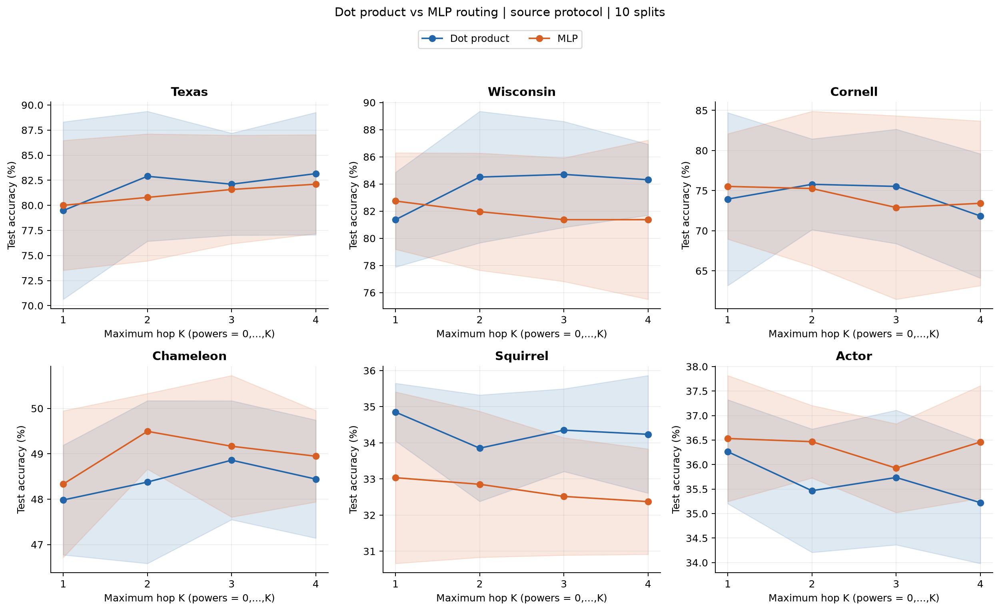
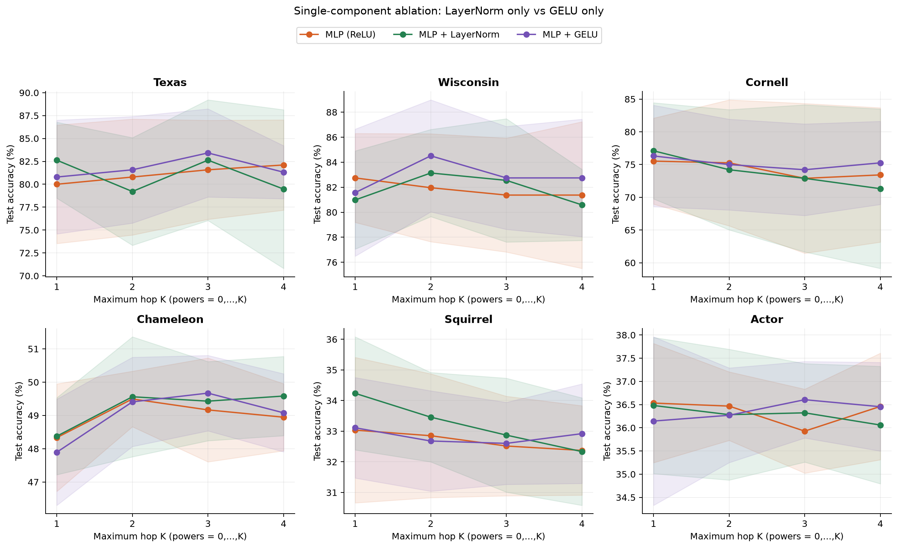
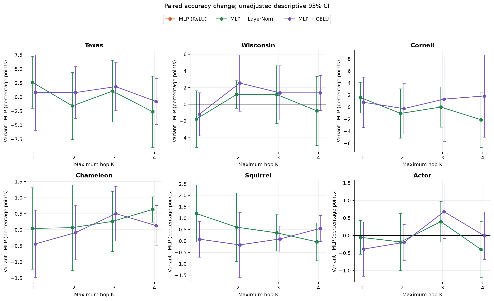
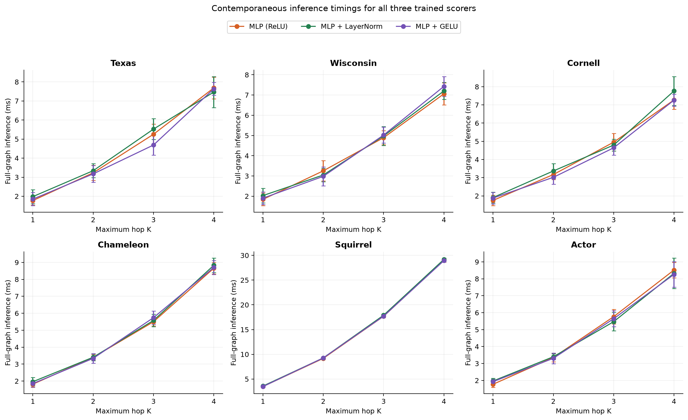

# Integrated major experiment results

This public report is newly generated from recovered records; originals remain
outside Git. Recovered records are pre-git and cannot be assigned the import commit
as their execution version. Full recovery:1,566 entries;1,540 major/historical
records plus24 superseded pilots and2 anchors. Main tables de-duplicate repeated
Dot conditions, using1,140 method/K/Split cells. UniformK1 was not run.

| Contrast | Positive / tie / negative groups | MeanΔ pp | Holm-family significant gains |
| --- | --- | --- | --- |
| Dot−Uniform, K2–4 | 11/0/7 | +1.51 | 0/18 |
| MLP−Dot, K1–4 | 12/0/12 | −0.51 | 0/24 |
| LN−MLP, K1–4 | 13/1/10 | +0.02 | 0/24 |
| GELU−MLP, K1–4 | 15/0/9 | +0.47 | 0/24 |

No direct contrast establishes general superiority after its original Holm family.
GELU remains−0.04pp relative to Dot overall. Actor/GELU's K3-versus-K1 gain change
is+1.07pp, pHolm18=.03516; this is not the fixed-K3 direct contrast. All inference
is exploratory with overlapping splits and one optimization seed per split.

## Complete comparable main table

Test percent, equal-weight10-split mean±sampleSD(ddof1), powers0..K, hidden32,
one GAMMA layer+Linear, R2, validation-best deep-copy checkpoints.

| Dataset | K | Uniform % | Dot % | MLP % | MLP+LN % | MLP-GELU % |
| --- | --- | --- | --- | --- | --- | --- |
| Texas | 1 | NOT_RUN | 79.47 ± 8.84 | 80.00 ± 6.47 | 82.63 ± 4.15 | 80.79 ± 6.21 |
| Texas | 2 | 78.95 ± 9.20 | 82.89 ± 6.48 | 80.79 ± 6.33 | 79.21 ± 5.88 | 81.58 ± 5.82 |
| Texas | 3 | 76.05 ± 10.63 | 82.11 ± 5.08 | 81.58 ± 5.41 | 82.63 ± 6.59 | 83.42 ± 4.81 |
| Texas | 4 | 75.53 ± 9.45 | 83.16 ± 6.10 | 82.11 ± 4.93 | 79.47 ± 8.67 | 81.32 ± 2.90 |
| Wisconsin | 1 | NOT_RUN | 81.37 ± 3.49 | 82.75 ± 3.56 | 80.98 ± 3.93 | 81.57 ± 5.08 |
| Wisconsin | 2 | 85.49 ± 4.73 | 84.51 ± 4.84 | 81.96 ± 4.32 | 83.14 ± 3.48 | 84.51 ± 4.48 |
| Wisconsin | 3 | 85.29 ± 4.26 | 84.71 ± 3.90 | 81.37 ± 4.55 | 82.55 ± 4.93 | 82.75 ± 4.11 |
| Wisconsin | 4 | 85.49 ± 3.72 | 84.31 ± 2.61 | 81.37 ± 5.86 | 80.59 ± 2.84 | 82.75 ± 4.69 |
| Cornell | 1 | NOT_RUN | 73.95 ± 10.78 | 75.53 ± 6.57 | 77.11 ± 7.34 | 76.32 ± 7.75 |
| Cornell | 2 | 71.58 ± 8.93 | 75.79 ± 5.66 | 75.26 ± 9.63 | 74.21 ± 9.18 | 75.00 ± 6.93 |
| Cornell | 3 | 70.26 ± 8.69 | 75.53 ± 7.13 | 72.89 ± 11.44 | 72.89 ± 11.24 | 74.21 ± 7.00 |
| Cornell | 4 | 70.53 ± 11.29 | 71.84 ± 7.75 | 73.42 ± 10.26 | 71.32 ± 12.18 | 75.26 ± 6.35 |
| Chameleon | 1 | NOT_RUN | 47.98 ± 1.21 | 48.33 ± 1.62 | 48.38 ± 1.16 | 47.89 ± 1.60 |
| Chameleon | 2 | 49.06 ± 1.27 | 48.38 ± 1.79 | 49.50 ± 0.83 | 49.56 ± 1.80 | 49.41 ± 1.34 |
| Chameleon | 3 | 49.32 ± 1.56 | 48.86 ± 1.31 | 49.17 ± 1.56 | 49.43 ± 1.19 | 49.67 ± 1.13 |
| Chameleon | 4 | 49.36 ± 1.19 | 48.44 ± 1.30 | 48.95 ± 1.01 | 49.58 ± 1.19 | 49.08 ± 1.17 |
| Squirrel | 1 | NOT_RUN | 34.85 ± 0.80 | 33.04 ± 2.37 | 34.24 ± 1.85 | 33.11 ± 1.64 |
| Squirrel | 2 | 32.91 ± 1.73 | 33.85 ± 1.47 | 32.85 ± 2.02 | 33.46 ± 1.46 | 32.68 ± 1.64 |
| Squirrel | 3 | 33.53 ± 1.87 | 34.35 ± 1.14 | 32.52 ± 1.63 | 32.87 ± 1.86 | 32.60 ± 1.34 |
| Squirrel | 4 | 33.08 ± 2.01 | 34.24 ± 1.63 | 32.37 ± 1.46 | 32.33 ± 1.75 | 32.92 ± 1.62 |
| Actor | 1 | NOT_RUN | 36.26 ± 1.06 | 36.53 ± 1.29 | 36.48 ± 1.47 | 36.14 ± 1.82 |
| Actor | 2 | 35.18 ± 0.90 | 35.47 ± 1.26 | 36.47 ± 0.74 | 36.28 ± 1.41 | 36.27 ± 1.02 |
| Actor | 3 | 35.22 ± 0.79 | 35.74 ± 1.37 | 35.93 ± 0.91 | 36.32 ± 1.06 | 36.61 ± 0.82 |
| Actor | 4 | 35.31 ± 1.26 | 35.22 ± 1.24 | 36.46 ± 1.15 | 36.06 ± 1.27 | 36.45 ± 0.96 |

## Cost and mechanism

MLP adds2,113 parameters to Dot; mean matched train-step+7.2%, inference+8.3%,
peak allocated memory+0.272MiB. LN adds64 more and GELU adds0. Fresh same-process
MLP/LN/GELU inference: LN+3.5%, GELU+0.8% vsMLP. Their train-step+4.2%/+1.3% and
memory+0.051/+0.044MiB are historical-baseline comparisons, not contemporaneous
three-method training measurements. Do not multiply cross-experiment timing ratios.

LN often reduces small-graph score scale and increases gate entropy, but Chameleon
can become more concentrated. GELU often sharpens gates; neither direction explains
accuracy universally. LN TexasK4−2.63pp/CornellK4−2.11pp and GELU WisconsinK1−1.18pp
remain negative cases (vsMLP). A high hop weight does not prove causal contribution.

## Figures

## Evidence and limits

[Registry](../experiments/registry.csv), [run metrics](../experiments/recovered_runs.jsonl),
[Dot/MLP analysis](../experiments/analysis/dot_mlp.json),
[component analysis](../experiments/analysis/mlp_components.json),
[gate scan](../experiments/analysis/gate_sweep.json), [historical README](../experiments/analysis/readme.json),
[early gate](../experiments/analysis/early_gate.json), [failure narrative](../experiments/HISTORICAL_FAILURES.md).

Earlier README100 runs retain shallow best-state behavior/non-strict GPU determinism
and cannot be mixed into these controls. InitialK2 gate120 runs use a different
initialization construction. Their raw results remain available in the linked
evidence rather than being pooled as extra splits. Scientific conclusions,
negative values and incomplete course evidence are retained; no tuning or training
was performed during repository recovery. Final course slides are still missing.
